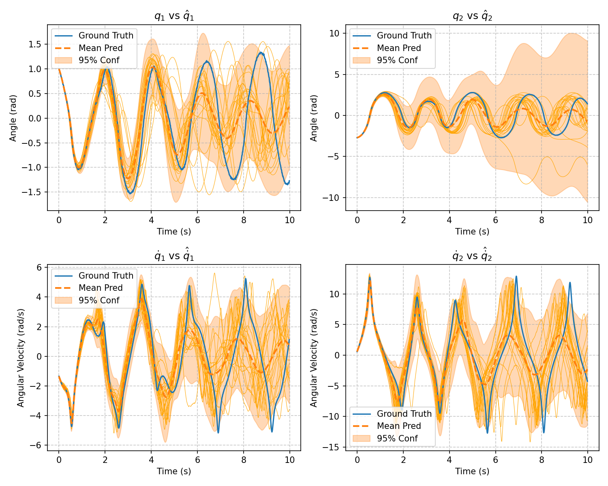
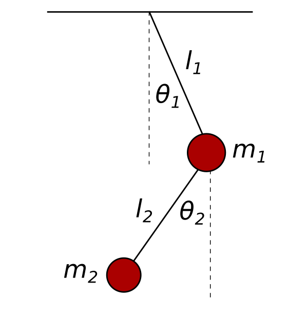
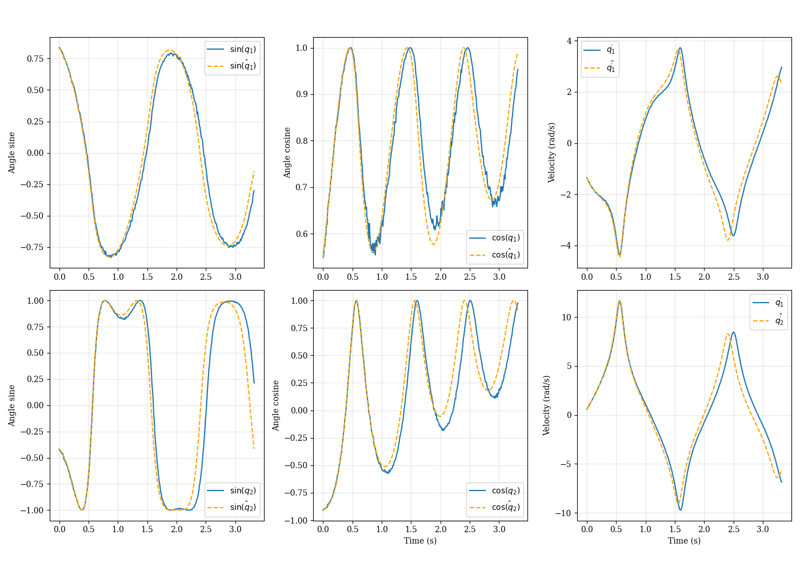

# Learning Complex Physical Systems: Double Pendulum

A comparison of **black-box, physics-informed and probabilistic neural models** for learning the dynamics of a chaotic double pendulum with friction, and for identifying its physical parameters ($m_1, m_2, l_1, l_2, b_1, b_2$) from state trajectories alone.

The motivation is industrial: measuring a system's physical parameters directly takes expensive instrumentation, while a model that recovers them from cheap state measurements can be used for control, diagnosis and anomaly detection.

Course project for *AI in Industry*, MSc Automation Engineering, University of Bologna (A.Y. 2025/2026).

<p align="center">
  
  <br><sub>Neuro-probabilistic model: Monte Carlo rollout with a 95% confidence band against the ground truth</sub>
</p>

## Approaches

| Family | Model | Idea |
|---|---|---|
| **Black box** | Feed-forward NN baseline | Learns $\ddot q = f(q, \dot q)$ from derivatives, or through *evolution training*: predictions are integrated with RK4 and the loss is computed on the rolled-out trajectory. Uses a trigonometric input layer, curriculum learning and sample weighting |
| | Neural ODE | Continuous-time model trained through the ODE solver (`torchdiffeq`, adjoint method) |
| **White box** | Parameter identification | Known Euler–Lagrange structure with learnable $m_i, l_i, b_i$, fitted end-to-end through the integrator |
| **Physics-informed** | Uninformed UDE | Universal Differential Equation: neural networks for $M(q)$, $C(q,\dot q)$, $D$, $G(q)$ inside $\ddot q = M^{-1}[\dots]$ |
| | Lagrangian NN | Network outputs the Lagrangian $\mathcal{L}$, and $\ddot q$ comes from automatic-differentiation Hessians. Near-perfect energy conservation, but struggles with friction |
| | Informed UDE | Adds structure: $M$ symmetric positive definite (Cholesky), diagonal friction, known constant terms. Stable, with physically meaningful parameters |
| | "More informed" UDE | Additionally anchors the learning with the inertia matrix, which gives the best parameter identifiability |
| **Probabilistic** | Neuro-probabilistic FNN | Predicts the mean and log-variance of $\ddot q$ (Gaussian NLL loss). Monte Carlo rollouts, optionally with dropout, give confidence regions for anomaly detection and MPC |

**Parameter identification result (white box):**

| | $m_1$ | $m_2$ | $l_1$ | $l_2$ | $b_1$ | $b_2$ |
|---|---|---|---|---|---|---|
| Estimated | 2.200 | 1.799 | 1.199 | 1.000 | 0.295 | 0.300 |
| True | 2.20 | 1.80 | 1.20 | 1.00 | 0.30 | 0.30 |

<table>
  <tr>
    <td align="center" width="30%"><br><sub>System model</sub></td>
    <td align="center" width="70%"><br><sub>Informed UDE: predicted vs true state evolution</sub></td>
  </tr>
</table>

## Data

The datasets are simulated rather than stored, so they're **not included** in the repo. They contain 100 double pendulums with random initial conditions, integrated for 1000 steps at `dt = 0.01`, in three friction regimes (none, low and high). Each sample includes the state, accelerations, energies and the dynamics terms $M, C, D, G$.

```bash
python gen.py            # simulate (set friction b1, b2 and the output CSV in the script)
python preprocessing.py  # energy-consistency filtering, white noise, equilibrium trimming
python splitter.py       # train / val / test split by pendulum
```

The data-inspection notes and plots are in [`considerations.md`](considerations.md) and [`plots/`](plots).

## Structure

| Path | Contents |
|---|---|
| `gen.py`, `simulation.py`, `models.py` | Double pendulum dynamics and data generation |
| `preprocessing.py`, `splitter.py`, `data_inspection.py` | Data cleaning, splitting and inspection |
| `branch1/` | One-step predictors, RNN and UDE pipelines (`main/`, `utils/`) plus training scripts (`scripts/`) |
| `branch2/` | Black-box FNN, Neural ODE, Lagrangian NN, parameter identification and probabilistic models (`train.py`, `train_probabilistic.py`, `test*.py`) |
| `presentation/` | Beamer slides (LaTeX) and figures |
| `figures/` | Architecture diagrams |

Built with PyTorch, torchdiffeq, NumPy, pandas and Matplotlib.

## Authors

- Francesco Cenni ([@Frasco-eng](https://github.com/Frasco-eng))
- Francesco Giordani ([@KNGLJordan](https://github.com/KNGLJordan))
- Giulio Mazzaroppi ([@Giulio-Mazzar](https://github.com/Giulio-Mazzar))
- Giacomo Pezzolati ([@giacomo2k2](https://github.com/giacomo2k2))

## References

- Greydanus et al., *Hamiltonian Neural Networks*, 2019 ([arXiv:1906.01563](https://arxiv.org/abs/1906.01563))
- Cranmer et al., *Lagrangian Neural Networks*, 2020 ([arXiv:2003.04630](https://arxiv.org/abs/2003.04630))
- Chen et al., *Neural Ordinary Differential Equations*, 2018 ([arXiv:1806.07366](https://arxiv.org/abs/1806.07366))
- Lutter et al., *Deep Lagrangian Networks*, 2019 ([arXiv:1907.04490](https://arxiv.org/abs/1907.04490))

## License

[MIT](LICENSE)
